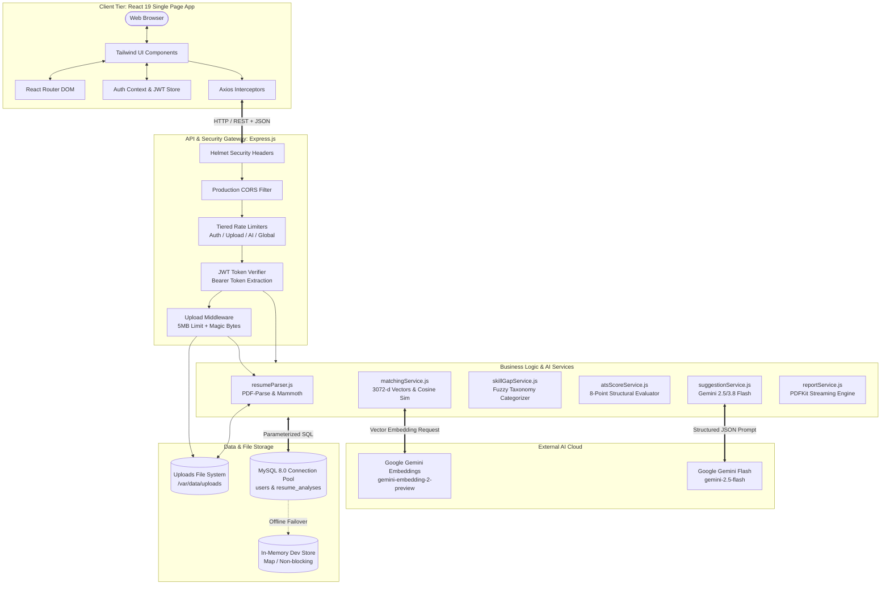
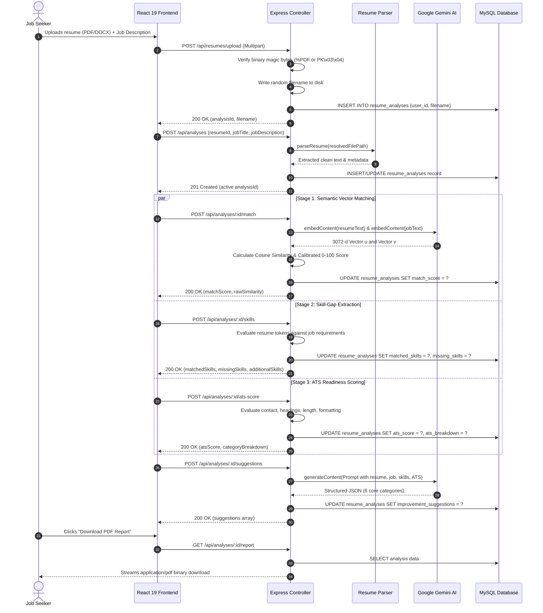
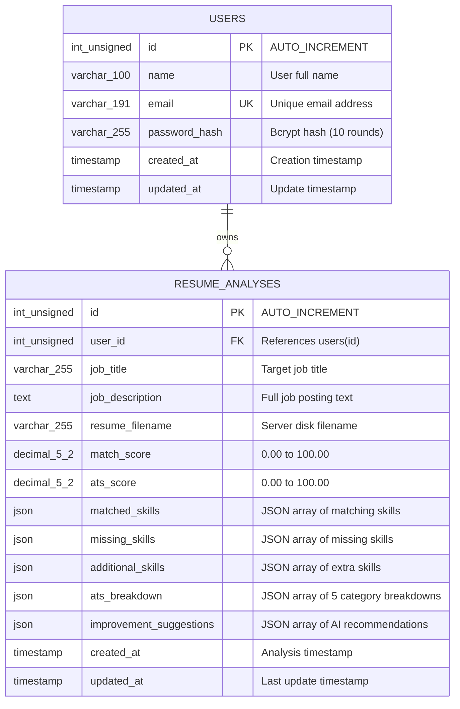

# System Architecture & Technical Specifications

This document details the architectural design, algorithmic models, database schemas, and data flow pipelines of the **AI-Powered Resume & Job Matcher**.

---

## 1. High-Level System Architecture

The application adopts a decoupled, multi-tier full-stack architecture optimized for responsiveness, security, and scalability:



---

## 2. Multi-Stage Pipeline Sequence

The core user experience is orchestrated through a 5-step analysis pipeline:



---

## 3. Component Architecture & State Management

### Frontend Architecture
- **Directory Structure:**
  - `src/components/`: Reusable presentation components (`Navbar`, `Footer`, `MatchScore`, `ATSReadinessScore`, `SkillGapAnalysis`, `ImprovementSuggestions`, `DownloadReportButton`).
  - `src/context/`: Context providers (`AuthContext.jsx` for authentication state and tokens; `ThemeContext.jsx` for dark/light theme switching).
  - `src/pages/`: Page views (`Home.jsx`, `AnalyzeResume.jsx`, `Results.jsx`, `MatchDetails.jsx`, `Dashboard.jsx`, `Login.jsx`, `Signup.jsx`, `NotFound.jsx`).
  - `src/services/`: API communication wrappers (`api.js`, `analysisService.js`, `resumeService.js`).
  - `src/utils/`: Error handling helpers (`apiErrorHandler.js`).
- **Axios Interceptor Pattern:**
  - **Request Interceptor:** Automatically reads `localStorage.getItem('token')` and appends `Authorization: Bearer <token>`.
  - **Response Interceptor:** Traps `401 Unauthorized` errors, clears expired tokens from storage, and dispatches a global `auth:unauthorized` window event that resets user state in `AuthContext`.
- **Dynamic Hydration on Page Refresh:**
  - The `MatchDetails` component (`/matches/:id`) dynamically loads complete analysis details from `GET /api/analyses/:id` via `useEffect`, allowing direct bookmarking and refreshing without relying on transient React memory state.

### Backend Architecture
- **Middleware Pipeline:**
  1. `helmet()`: Sets modern security headers (HSTS, frameguard, nosniff).
  2. `cors(corsOptions)`: Restricts cross-origin requests to configured domains.
  3. `express.json({ limit: '1mb' })` & `urlencoded({ limit: '1mb' })`: Guards against payload exhaustion DoS attacks.
  4. `rateLimiter`: Applies specialized limits (`authLimiter`, `uploadLimiter`, `aiAnalysisLimiter`, `apiLimiter`).
  5. `verifyToken`: Validates JWT signature, expiration, and extracts `req.userId`.
  6. `uploadResumeMiddleware`: Handles Multer ingestion and disk verification.
- **Controller Layer:**
  - `authController.js`: Registration, login authentication, password comparison via bcrypt, and profile queries.
  - `resumeController.js`: Resume uploads and text extraction.
  - `analysisController.js`: Analysis creation, matching, skill analysis, ATS evaluation, suggestions, dashboard analytics, pagination, and PDF generation.

---

## 4. Mathematical Model: Semantic Vector Matching

### 1. Vector Space Representation
Modern large language models represent text as dense vector embeddings in a continuous semantic hyperspace:
$$\mathbf{u} = \operatorname{Embed}(\text{Resume Text}) \in \mathbb{R}^{d}, \quad \mathbf{v} = \operatorname{Embed}(\text{Job Description}) \in \mathbb{R}^{d}$$
where $d = 3,072$ dimensions in `gemini-embedding-2-preview` (or $768$ dimensions in `text-embedding-004`).

### 2. Cosine Similarity Formula
Cosine similarity measures the cosine of the angle between two multi-dimensional vectors, evaluating orientation rather than document length:

$$\operatorname{CosineSimilarity}(\mathbf{u}, \mathbf{v}) = \frac{\mathbf{u} \cdot \mathbf{v}}{\|\mathbf{u}\|_2 \|\mathbf{v}\|_2} = \frac{\sum_{i=1}^{d} u_i v_i}{\sqrt{\sum_{i=1}^{d} u_i^2} \sqrt{\sum_{i=1}^{d} v_i^2}}$$

### 3. Normalization & Calibration Function
In professional English documents, cosine similarities for resume-to-job comparisons rarely fall below $0.50$ (unrelated careers) or exceed $0.85$ (exceptionally close alignment). 

To provide intuitive 0–100% scores for human review, raw cosine similarity $S_{\text{raw}}$ is mapped through a piece-wise linear calibration function:

$$\text{Match Score} = \operatorname{clamp}\left(0, 100, \left(\frac{S_{\text{raw}} - S_{\min}}{S_{\max} - S_{\min}}\right) \times 100\right)$$

Where:
- $S_{\min} = 0.50$ (0% match baseline)
- $S_{\max} = 0.85$ (100% match ceiling)

```
Raw Cosine Similarity (S_raw)      Calibrated Score    Qualitative Tier
-------------------------------------------------------------------------
S_raw >= 0.78                     80% - 100%          Excellent Match
0.72 <= S_raw < 0.78              65% - 79%           Good Match
0.65 <= S_raw < 0.72              45% - 64%           Moderate Match
S_raw < 0.65                      0% - 44%            Low Match
```

---

## 5. ATS Readiness Evaluation Model

The ATS evaluation engine (`atsScoreService.js`) audits the extracted resume text against 5 core recruitment criteria totaling 100 maximum points:

| Evaluation Dimension | Max Points | Inspection Rules & Detection Logic |
| :--- | :---: | :--- |
| **Contact Information** | 20 pts | Detects valid email addresses, phone numbers (10–15 digits), and optional professional links (LinkedIn, GitHub, portfolio). |
| **Standard Headings** | 25 pts | Verifies presence of recognized resume headings: Experience / Work History, Education, Skills, and Summary / Profile. |
| **Technical Skills Section** | 25 pts | Checks for a dedicated, categorized skills section containing recognized industry terminology. |
| **Document Length & Density** | 15 pts | Evaluates word count bounds (optimal: 350–1,500 words). Penalizes overly concise (<200 words) or excessively verbose (>2,500 words) documents. |
| **Formatting & Readability** | 15 pts | Assesses average sentence length, paragraph density, bullet-point usage, and absence of corrupted formatting artefacts. |

---

## 6. Database Schema & Indexing Design

The MySQL relational database schema enforces strict referential integrity, check constraints, and indexing for high-throughput queries:

### Entity-Relationship Diagram



### Table Definitions & Constraints
```sql
CREATE TABLE IF NOT EXISTS `users` (
  `id` INT UNSIGNED NOT NULL AUTO_INCREMENT,
  `name` VARCHAR(100) NOT NULL,
  `email` VARCHAR(191) NOT NULL,
  `password_hash` VARCHAR(255) NOT NULL,
  `created_at` TIMESTAMP NOT NULL DEFAULT CURRENT_TIMESTAMP,
  `updated_at` TIMESTAMP NOT NULL DEFAULT CURRENT_TIMESTAMP ON UPDATE CURRENT_TIMESTAMP,
  PRIMARY KEY (`id`),
  UNIQUE KEY `uk_users_email` (`email`),
  KEY `idx_users_created_at` (`created_at`)
) ENGINE=InnoDB DEFAULT CHARSET=utf8mb4 COLLATE=utf8mb4_unicode_ci;

CREATE TABLE IF NOT EXISTS `resume_analyses` (
  `id` INT UNSIGNED NOT NULL AUTO_INCREMENT,
  `user_id` INT UNSIGNED NOT NULL,
  `job_title` VARCHAR(255) DEFAULT NULL,
  `job_description` TEXT NOT NULL,
  `resume_filename` VARCHAR(255) NOT NULL,
  `match_score` DECIMAL(5, 2) DEFAULT NULL,
  `ats_score` DECIMAL(5, 2) DEFAULT NULL,
  `matched_skills` JSON DEFAULT NULL,
  `missing_skills` JSON DEFAULT NULL,
  `additional_skills` JSON DEFAULT NULL,
  `ats_breakdown` JSON DEFAULT NULL,
  `improvement_suggestions` JSON DEFAULT NULL,
  `created_at` TIMESTAMP NOT NULL DEFAULT CURRENT_TIMESTAMP,
  `updated_at` TIMESTAMP NOT NULL DEFAULT CURRENT_TIMESTAMP ON UPDATE CURRENT_TIMESTAMP,
  PRIMARY KEY (`id`),
  KEY `idx_resume_analyses_user_id` (`user_id`),
  KEY `idx_resume_analyses_user_created` (`user_id`, `created_at` DESC),
  CONSTRAINT `chk_match_score_range` CHECK (`match_score` IS NULL OR (`match_score` >= 0 AND `match_score` <= 100)),
  CONSTRAINT `chk_ats_score_range` CHECK (`ats_score` IS NULL OR (`ats_score` >= 0 AND `ats_score` <= 100)),
  CONSTRAINT `fk_resume_analyses_user` 
    FOREIGN KEY (`user_id`) 
    REFERENCES `users` (`id`) 
    ON DELETE CASCADE 
    ON UPDATE CASCADE
) ENGINE=InnoDB DEFAULT CHARSET=utf8mb4 COLLATE=utf8mb4_unicode_ci;
```

---

## 7. Storage Architecture: Ephemeral vs. Persistent

```
+-------------------------------------------------------------+
| Container / VM Boundary                                     |
|                                                             |
|  [ Express Backend API Service ]                            |
|             │                                               |
|             │ (Resolves via getUploadDir())                 |
|             ▼                                               |
|  +-------------------------------------------------------+  |
|  | Persistent Mount: /var/data/uploads                   |  |
|  | - resume_1741..._a8f9c...pdf                          |  |
|  | - resume_1741..._e2c1b...docx                         |  |
|  +-------------------------------------------------------+  |
+-------------------------------------------------------------+
        ▲
        │ (Survives container restarts, redeployments & scale-to-zero)
+-------------------------------------------------------------+
| Persistent Volume Block / Cloud Disk (Render / AWS EBS)     |
+-------------------------------------------------------------+
```

1. **The Ephemeral Filesystem Problem:** Cloud platforms (Render, Railway, Heroku, Docker) use ephemeral filesystems. When a web service redeploys or restarts, local directory changes are lost.
2. **The Persistent Solution:**
   - The application configures `UPLOADS_DIR` (e.g. `/var/data/uploads` on Render Persistent Disks).
   - `backend/config/storage.js` evaluates `process.env.UPLOADS_DIR` at runtime and ensures synchronous folder existence.
   - If not set, it defaults safely to local `./backend/uploads` for offline local development.
